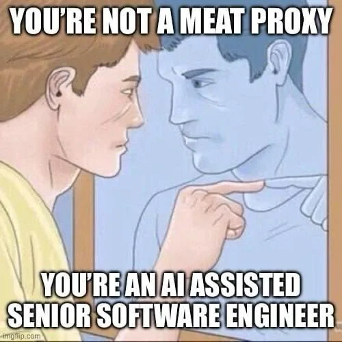

# NOMOREMEATPROXY

## Stop being your AI team's clipboard.

**Let Codex and Claude exchange context, questions and reviews through their own CLIs.**
Get a second opinion, continue a project conversation, and bring the answer back without
copy-pasting between assistants.

[Quickstart](#quickstart) · [User guide](docs/usage.md) · [Known limits](#known-limits)

<p align="center">
  
</p>

### Two assistants. Less relay work.

- **Get another perspective.** Plan with one assistant; ask the other to challenge the
  assumptions, review an implementation or look for missing tests.
- **Keep the conversation going.** Continue a project-scoped thread instead of starting
  every handoff from scratch.
- **Find the context, not another tab.** Search titles or recent message content on either
  side, then read a compact conversation.
- **Know where the handoff goes.** Inspect routes without sending, follow requests, and
  see reported call usage instead of guessing.

NOMOREMEATPROXY is a local CLI bridge, not another chat service. Use supported subscription
sign-ins for the vendor CLIs; your vendors' model access and usage limits still apply.

## Quickstart

**Bring your own prerequisites:** Node.js **22.15+**, Codex CLI and Claude Code CLI,
installed and signed in with supported subscriptions. Desktop apps are needed to see chats
there. This package does not install prerequisites, sign you in or configure your assistants.

### 1. Install the bridge

```bash
npm install --global nomoremeatproxy@0.1.0
nomeat --help
nomeat peers
```

Prefer a one-off look? `npx --yes nomoremeatproxy@0.1.0 --help`.
Version 0.1.0 was published on 2026-11-11; registry installation and a one-off run were
checked on Windows that day.

### 2. Connect it to your project

Run this **from the project you want the assistants to work in**:

```bash
nomeat orient --from astra
```

`orient` inspects routes and state without creating folders or sending messages. It does
not prove delivery. Give both assistants the [peer-call instructions](templates/peer-calls.md)
and follow the [setup guide](docs/usage.md#requirements). For calls into an already-open
Claude Desktop chat, configure its [listener](docs/usage.md#calls-into-the-claude-chat-you-are-sitting-in).

### 3. Ask for a second opinion

Once your chosen route is ready:

```bash
nomeat call --to fable --from astra --message "Review this project's architecture. What would you challenge?"
```

This sends a real message and returns the peer's answer. The receiving session's access
still matters. `astra` and `fable` are built-in peer roles, not proof of which model is
running. Defaults are fixed; inspect `nomeat peers` and use the documented
[model and thinking overrides](docs/usage.md#calling-a-peer) where supported by the route.

### Prefer a source checkout?

```bash
git clone https://github.com/KanuToCL/nomoremeatproxy.git
cd nomoremeatproxy
npm run doctor
node bin/nomeat.mjs --help
```

The bridge has no package dependencies or install hooks. `doctor` checks prerequisites
without sending messages; run it from the checkout or installed package directory, not an
unrelated project. It is not a separate command added to your PATH. App/browser probes are
Windows-only. Source examples use `node bin/nomeat.mjs`; an installed CLI uses `nomeat`.

## How it works

1. **Call from your project.** An assistant invokes `nomeat` with a peer and a question.
2. **Route through the vendor CLI.** The bridge starts or continues a conversation, or
   hands the request to a listening Claude Desktop chat.
3. **Bring the answer back.** The caller gets the reply; `find`, `read` and `check` help
   recover context and follow up on work.

The bridge keeps local routing and delivery state. Both assistants must use the same
[state folder](docs/usage.md#state). Installation alone is not an end-to-end delivery test.

## Known limits

Useful today, with real boundaries:

| Area | What to know |
|---|---|
| Setup | CLI-only, with manual prerequisites, sign-ins and assistant instructions. Web chats and automatic setup are not supported. |
| Models | Four fixed peer defaults may not fit your account. Overrides depend on the route; queued/attended chats keep their existing settings. |
| Desktop UX | New Codex chats can appear late. Opening a chat can switch you away from your current one. A question card raised before a chat appears can be lost; prefer questions in the returned answer. |
| Linux | The vendor offers no opener to list a new bridge chat in Claude Desktop. A listening desktop chat is the alternative. Sandboxes can also block network/state access on Linux and macOS. |
| Validation | Windows is the primary development platform. Platform observations are not a clean-machine or reboot guarantee. |

Read the [full platform observations and untested cases](docs/usage.md#detailed-platform-observations)
before relying on desktop listing or owner question cards.

## Go deeper

- [User guide](docs/usage.md): commands, routing, history, retries, state and platform behavior.
- [Assistant instructions](templates/peer-calls.md): permission-aware calls and replies.
- [Contributor guide](https://github.com/KanuToCL/nomoremeatproxy/blob/main/AGENTS.md): local tests and safe development.

MIT licensed. See [LICENSE](LICENSE).
